<div align="center">

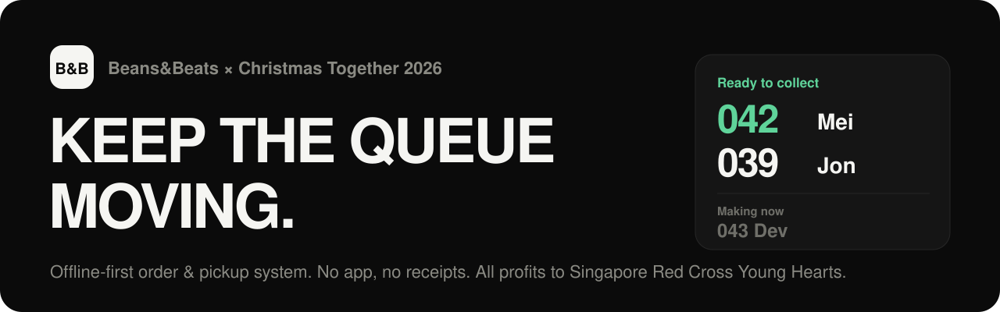

<br>

**The offline-first order & pickup queue for the beans&beats coffee-clubbing booth at Christmas Together 2026.**<br>
Baristas tap once per step. Guests can open a tracking link and get a notification when their drink is ready.<br>
No app to download, no paper receipts, and it keeps working when the hall wifi drops.

<br>

[](https://github.com/likalight/beans-beats-queue/actions/workflows/ci.yml)
[](https://beans-beats-queue.onrender.com)
[](https://beans-beats-queue.onrender.com/film)
[](package.json)
[](public/sw.js)
[](#-deploy-for-free)
[](LICENSE)

[**Live app**](https://beans-beats-queue.onrender.com) · [**Live cockpit**](https://beans-beats-queue.onrender.com/demo) · [Demo video](https://beans-beats-queue.onrender.com/film) · [Technical summary (PDF)](docs/technical-summary.pdf) · [Demo script](docs/demo-script.md)

<br>

<a href="https://beans-beats-queue.onrender.com/demo">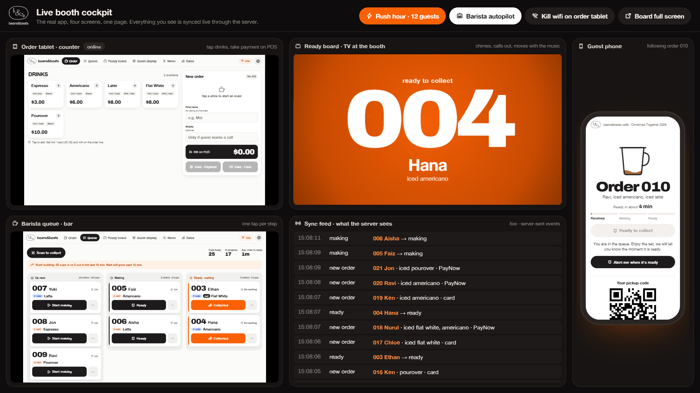</a>

<sub><b>The live cockpit</b> (<code>/demo</code>): four real copies of the app side by side. Press <b>Rush hour</b>, kill the order tablet's wifi, and watch everything sync.</sub>

</div>

---

## Contents

- [Why](#-why)
- [Features](#-features)
- [Try it in 30 seconds](#-try-it-in-30-seconds)
- [How a cup moves through the booth](#-how-a-cup-moves-through-the-booth)
- [Screenshots](#-screenshots)
- [Quick start](#-quick-start)
- [Configuration](#%EF%B8%8F-configuration)
- [Deploy for free](#-deploy-for-free)
- [Architecture](#-architecture)
- [Guest notifications](#-guest-notifications)
- [Personal data & PDPA](#-personal-data--pdpa)
- [Testing](#-testing)
- [Running the event](#-running-the-event)
- [Known limitations](#%EF%B8%8F-known-limitations)
- [Roadmap](#-roadmap)
- [Contributing](#-contributing)
- [Acknowledgements](#-acknowledgements)
- [License](#-license)

## 💡 Why

Christmas Together 2026 runs for four days in Hall F at Marina Bay Sands. The beans&beats booth sells specialty coffee to a crowd that's there for the DJ, and **all profits go to Singapore Red Cross Young Hearts**. A paper-ticket queue fails in that room. It's loud, guests wander off, baristas lose track during a rush, and the hall wifi can't be trusted.

This project replaces the paper:

- **The counter** keys an order on the iPad, including **custom off-menu drinks** with their own price, and gives the guest an order number. Staff can share a tracking link or show its QR code.
- **The bar** sees one clean queue and moves each cup along with one tap: *Up next → Making → Ready → Collected*.
- **The guest** can follow the order on their phone and turn on a **ready notification**. They can also share a card showing their support for the beneficiary.
- **The booth lead** gets live stats, stock warnings, menu controls, and a daily CSV that matches the POS.

## ✨ Features

| | For | Feature |
|---|---|---|
| ☕ | Counter | **Tap-to-pick drink sheet**: hot/iced, milk and cups in one small sheet. Drinks with no choices are added in one tap. Surcharges apply automatically. |
| ✍️ | Counter | **Custom item**: a guest asks for a piccolo that isn't on the menu? Type the name and price and it flows through the queue, board, guest page and report like any other drink, tagged `CUSTOM`. |
| 📲 | Counter | **Send to bar** records PayNow or card for reconciliation. Share the tracking link or show its QR on request. |
| 🧑‍🍳 | Baristas | Three lanes with one action per step. Mark pickup with **Collected**. The booth lead can enable camera pickup scanning. |
| 🔔 | Guests | **Ready notifications** are optional. Web Push can reach the lock screen, with Add to Home Screen guidance on iPhone and in-page sound as a fallback. |
| 🥤 | Guests | Order number, status, and estimated wait. A pickup QR appears when the order is ready and pickup scanning is enabled. |
| 📸 | Guests | **Shareable story card**: a 1080×1920 *"I sipped for Young Hearts"* image made on the phone for Instagram. |
| 📺 | Booth | **Ready board** with ready and making lists, optional donation progress, and sound controls. The tracking QR appears automatically for the latest order for up to 90 seconds. |
| 🧠 | Lead | **Booth insights** in plain language: *"Oat milk runs out around 3:40 pm at this pace"*, *"Rush building: 25 cups in vs 5 out"*. |
| 📊 | Lead | **Daily sales report** with KPIs, per-drink and per-hour breakdowns, CSV export per order, and **Close day** with a PDPA wipe. |
| 📶 | Everyone | **Offline-first**: every tap is saved on the device first, then synced idempotently. Wifi drops never lose or duplicate an order. |
| 🆓 | Ops | **$0 hosting**: Render free, Upstash Redis free and GitHub Actions. Orders survive restarts and the service never sleeps. |

## 🎯 Try it in 30 seconds

| Role | PIN | Opens |
|---|---|---|
| **Barista** | `2345` | Order screen, barista queue, ready board, and optional pickup scanning |
| **Booth lead** | `3456` | Everything above, plus stats, insights, menu controls and the daily sales report |
| **Guest** | none | Open the order link shared at the counter or [`/m`](https://beans-beats-queue.onrender.com/m) for the menu |
| **Judge** | `3456` | Open [**`/demo`**](https://beans-beats-queue.onrender.com/demo), log in once, press **Start**, then **Rush hour**. Turn the sound on. |

> [!NOTE]
> These PINs are for the [live demo](https://beans-beats-queue.onrender.com). A local copy (`npm start`) uses the defaults `1111` / `9999`. The event deployment switches to private PINs through `BARISTA_PIN` and `LEAD_PIN`.

## 🔁 How a cup moves through the booth

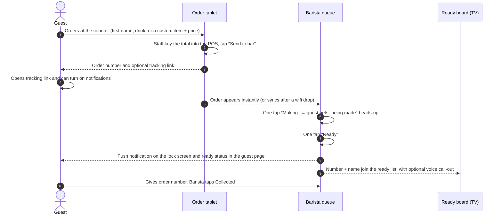

## 📸 Screenshots

These screenshots are from the original demo.

<table>
<tr>
<td width="62%">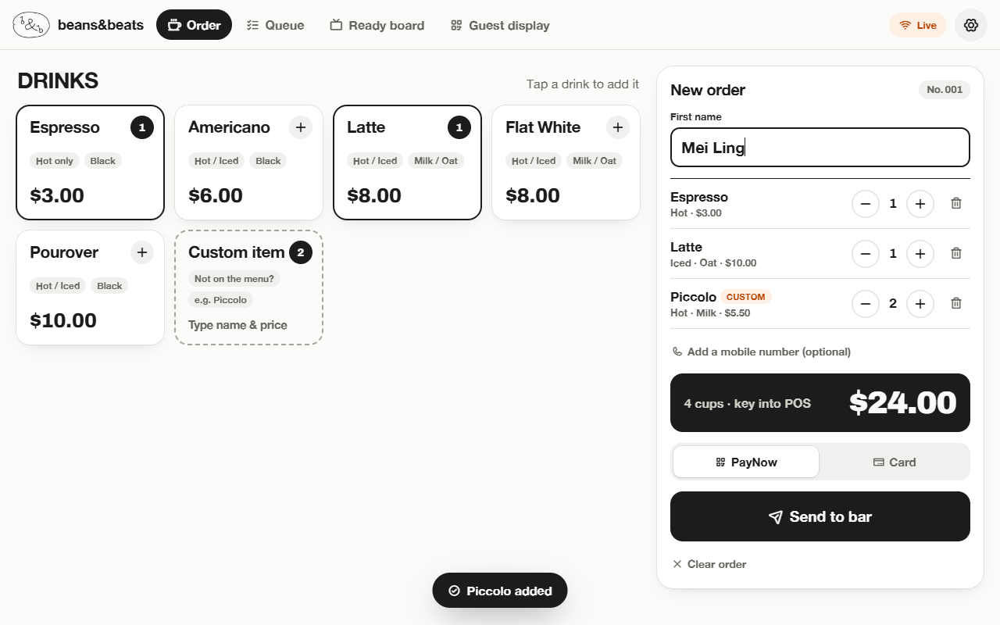<br><b>Order screen.</b> Tap a drink, the cart builds on the right, then one <i>Send to bar</i>.</td>
<td width="38%">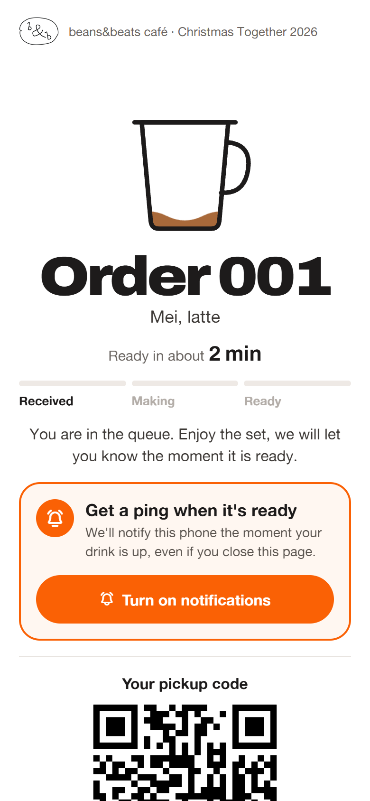<br><b>Guest page.</b> The notification prompt is the first thing a guest sees.</td>
</tr>
<tr>
<td>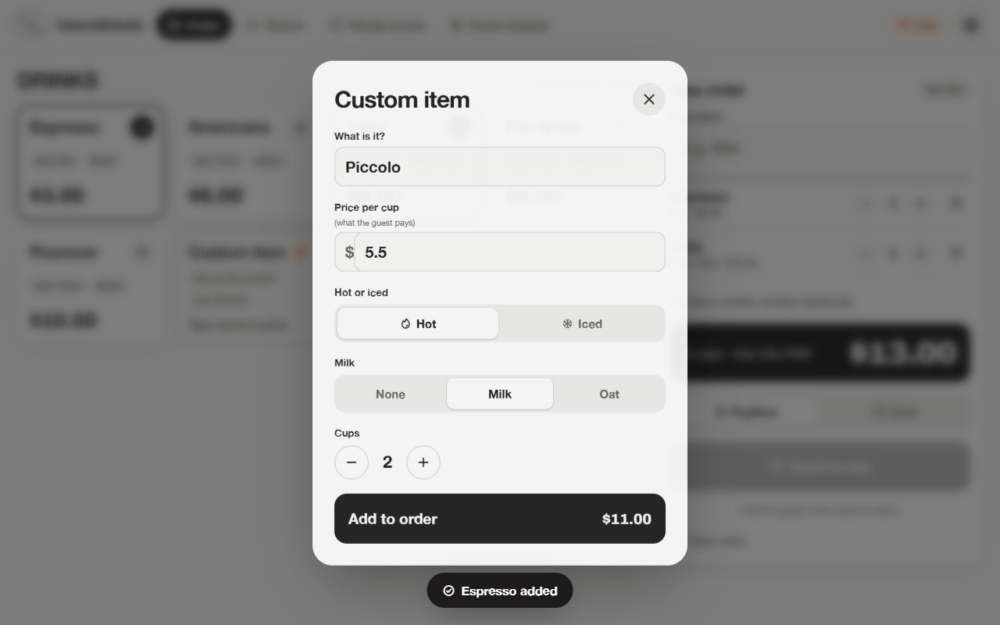<br><b>Custom item.</b> Name and price typed on the spot, for anything off the menu.</td>
<td>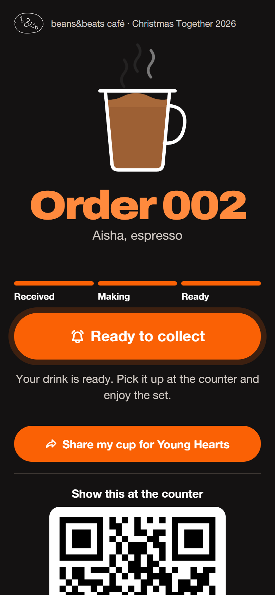<br><b>Ready.</b> Lock-screen push, chime, vibration and a pickup QR.</td>
</tr>
<tr>
<td>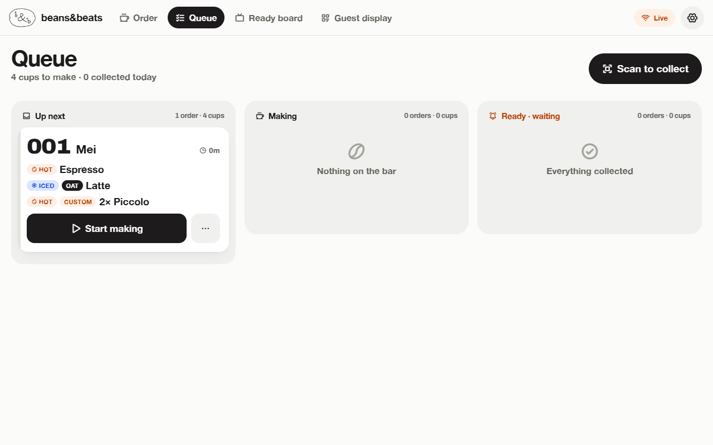<br><b>Barista queue.</b> Up next, Making, Ready. One tap each. Scan to collect.</td>
<td>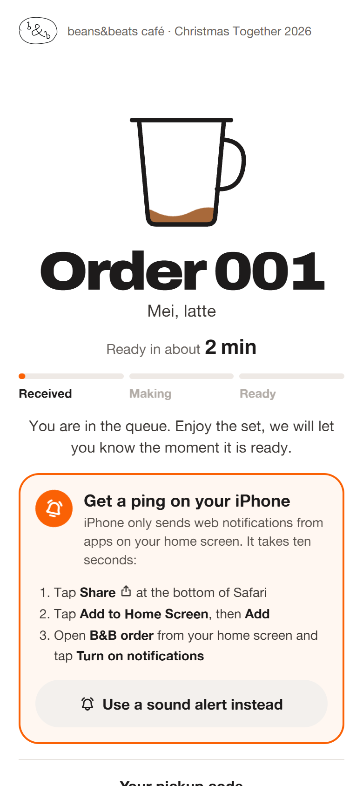<br><b>iPhone.</b> Guided Add to Home Screen for lock-screen alerts.</td>
</tr>
<tr>
<td>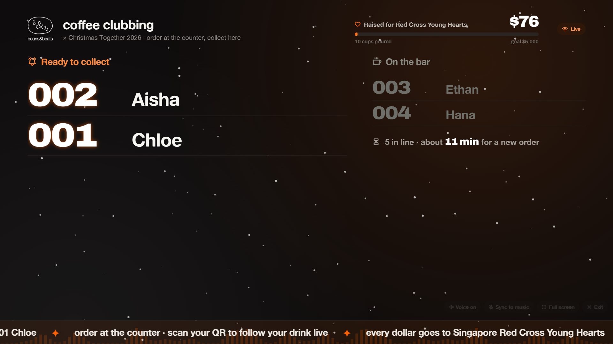<br><b>Ready board.</b> Ready and making lists with a charity meter.</td>
<td>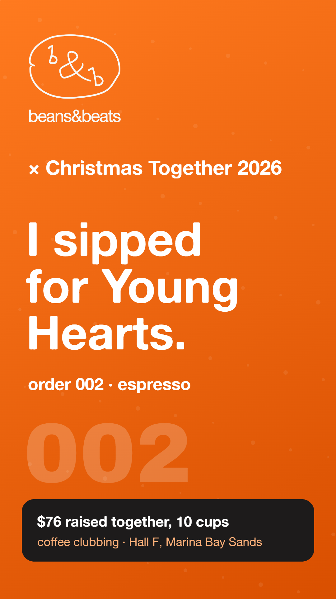<br><b>Story card.</b> Shared from the phone after pickup.</td>
</tr>
<tr>
<td>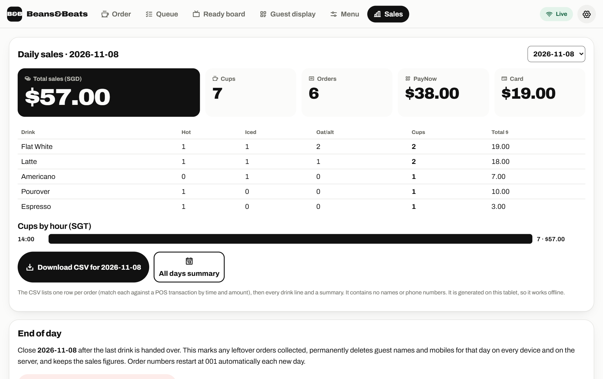<br><b>Daily sales.</b> KPIs, breakdowns, CSV per order for the POS.</td>
<td>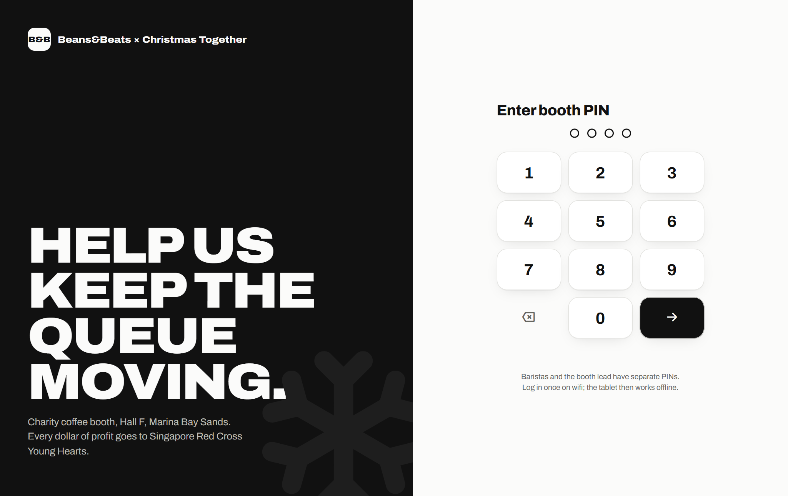<br><b>Staff login.</b> Tablet keypad, barista and lead PINs.</td>
</tr>
</table>

## 🚀 Quick start

**Requirements:** Node.js 20 or newer. No database, no build step.

```bash
git clone https://github.com/likalight/beans-beats-queue.git
cd beans-beats-queue
npm install
npm start            # http://localhost:3000  (barista 1111, lead 9999)
```

```bash
npm run dev          # restart on file changes
npm run test:all     # smoke + storage tests
```

| Route | What |
|---|---|
| `/order` | Counter: take orders |
| `/queue` | Bar: Up next / Making / Ready, with manual collection and optional pickup scanning |
| `/board` | Ready board for the separate monitor |
| `/display` | Guest-facing second screen (latest QR, menu when idle) |
| `/menu` · `/report` | Lead: menu controls · daily sales |
| `/o/<token>` | Guest status page (from the QR) |
| `/m` | Public read-only menu |
| `/demo` | Live cockpit: the whole booth on one screen |

## ⚙️ Configuration

Everything is optional. See [`.env.example`](.env.example).

| Variable | Default | Purpose |
|---|---|---|
| `PORT` | `3000` | HTTP port |
| `DATA_DIR` | `./data` | Local op log, keys, push subscriptions |
| `BARISTA_PIN` / `LEAD_PIN` | `1111` / `9999` | Staff PINs. **Change for the live event.** |
| `UPSTASH_REDIS_REST_URL` / `UPSTASH_REDIS_REST_TOKEN` | unset | Durable storage on hosts with an ephemeral disk. See [Deploy for free](#-deploy-for-free). |
| `REDIS_PREFIX` | `bb:` | Key prefix, so several booths can share one database |
| `SESSION_SECRET` | generated | HMAC key for staff tokens (kept in `DATA_DIR` and Redis) |
| `VAPID_PUBLIC_KEY` / `VAPID_PRIVATE_KEY` | generated | Web Push keys (`npx web-push generate-vapid-keys`) |
| `VAPID_SUBJECT` | `mailto:general@beansnbeats.com` | Contact for push services |

## 🆓 Deploy for free

The production setup costs **$0/month** and needs no credit card:

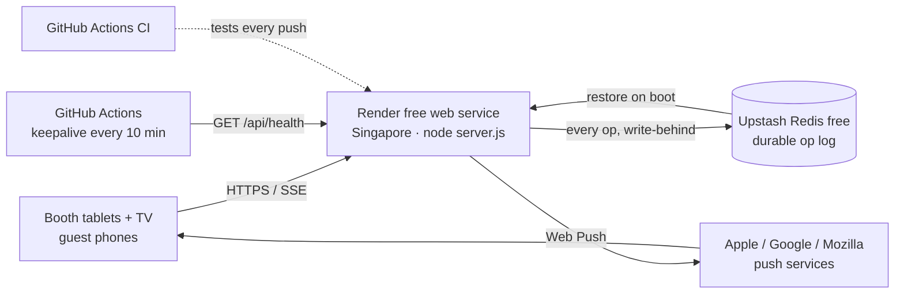

| Piece | Free tier | Solves |
|---|---|---|
| [Render](https://render.com) web service | 750 instance-hours a month, HTTPS, auto-deploy from `main` | Hosting, TLS (needed for service worker, push and camera) |
| [Upstash Redis](https://upstash.com) | 256 MB, 500K commands a month (one booth day is a few thousand) | Render free has **no persistent disk**. The op log, keys and push subscriptions are mirrored to Redis and restored on boot. |
| [GitHub Actions](.github/workflows/keepalive.yml) keepalive | Free for public repos | Render free sleeps after 15 idle minutes (about a 50 s cold start). A ping every 10 minutes keeps it awake. |
| [GitHub Actions](.github/workflows/ci.yml) CI | Free for public repos | Smoke and storage tests on Node 20 and 22 for every push and PR |

**Set it up (about 5 minutes):**

1. **Database.** Create a free Redis database at [console.upstash.com](https://console.upstash.com), choosing a region near Singapore. On its page, under **REST API**, copy `UPSTASH_REDIS_REST_URL` and `UPSTASH_REDIS_REST_TOKEN`.
2. **Web service.** In Render, choose **New → Blueprint** and pick this repo. [`render.yaml`](render.yaml) creates a free Singapore service with a health check. Paste the two Upstash values and set your own `BARISTA_PIN` and `LEAD_PIN`.
3. **Keepalive.** The [keepalive workflow](.github/workflows/keepalive.yml) already pings `beans-beats-queue.onrender.com`. For a different URL, add a repository variable `LIVE_URL`.
4. **Check it.** `GET /api/health` should return `"storage":"redis"` and `"pending":0`.

How the storage works ([`store.js`](store.js)): the server keeps reading and writing local files for speed. Every op is also `RPUSH`ed to Redis through an ordered, retrying queue, which is flushed on `SIGTERM` during a deploy. On boot, the log is pulled back to disk before anything else runs. If Redis is unreachable at boot, the server refuses to start rather than fork history, and the host restarts it.

<details>
<summary><b>Other ways to host</b></summary>

- **Docker, anywhere with a volume:** `docker build -t beans-beats-queue . && docker run -p 3000:3000 -v bbdata:/data -e BARISTA_PIN=… -e LEAD_PIN=… beans-beats-queue`
- **Any VM** (e.g. Oracle Cloud Always Free): `npm ci --omit=dev && node server.js` behind Caddy for automatic HTTPS. The local disk persists, so Redis is optional.
- **Render paid plan with a disk:** remove the Upstash variables and add a disk at `DATA_DIR`.

Run **one instance**. The server is the single writer of the op log.
</details>

## 🧱 Architecture

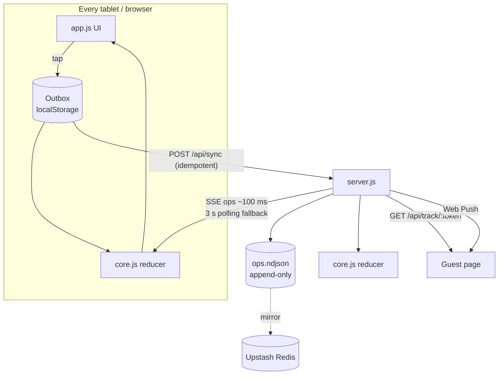

- **Ops, not rows.** Every action becomes an op `{opId, type, at, device, payload}` that is saved on the device *before* the screen updates.
- **One reducer everywhere.** [`public/shared/core.js`](public/shared/core.js) runs on the server and in every browser, so all devices derive the same state from the same ops.
- **Idempotent sync.** `POST /api/sync` accepts the outbox (retries never duplicate) and returns everything the device missed.
- **Deterministic conflicts.** Creation is first-write-wins on a UUID. Status only moves forward, and menu edits are last-writer-wins by timestamp.
- **Collision-free numbers offline.** Each order station owns a number series. Numbers reset at midnight Singapore time.
- **Data epochs.** A full reset changes the epoch, so tablets drop their cached copies automatically.

```
server.js               HTTP, sync API, SSE, Web Push, PII scrub
store.js                Upstash Redis mirror (restore on boot, write-behind queue)
public/shared/core.js   reducer, conflict rules, ETA, reports, CSV (server + browser)
public/app.js           staff app: order, queue, board, display, menu, report, scanner
public/guest.*          guest page: cup, ETA, notifications, pickup QR, story card
public/stage.js         optional ready-board chimes and voice call-outs
public/sw.js            offline shell + push notifications
scripts/reset-day.js    close a day / full wipe (also clears Redis)
test/                   smoke.js (end-to-end), storage.js (restart + restore)
.github/workflows/      CI and keepalive
```

| Layer | Choice | Why |
|---|---|---|
| Server | Node 22, plain `http`, NDJSON op log | Nothing to break on event day: one process, replayable history |
| Realtime | Server-Sent Events + polling | Survives proxies and flaky wifi |
| Client | Vanilla JS PWA, no build step | Fast on budget tablets, fully cached for offline |
| Alerts | Web Push (`web-push`), Web Audio, Vibration, Wake Lock | Lock-screen alerts with in-page fallbacks |
| QR | `qrcode-generator`, `jsQR` + `BarcodeDetector` | Paperless ordering and camera collection |
| Storage | Local files + Upstash Redis REST | Fast and offline-safe, durable on free hosts, no client library |

## 🔔 Guest notifications

Browsers only allow notifications after the user taps something, so no website can switch them on silently. The guest page makes that one tap obvious:

| Guest's browser | What they see | What happens |
|---|---|---|
| Android Chrome, desktop browsers, iPhone home-screen app | Orange **Turn on notifications** card | Web Push subscription. A *"being made"* heads-up, then a sticky *"Order 012 is ready"* on the lock screen, even with the page closed. |
| iPhone in Safari | **Add to Home Screen** steps (Share → Add to Home Screen → open → Turn on) | Each order gets its own web-app manifest, so the home-screen icon opens straight to that order. Requires iOS 16.4+. |
| Notifications blocked | How to unblock, plus **Turn on sound alert** | Chime, vibration and screen wake lock while the page is open |
| Already allowed (reload, second order) | Green "Notifications on" with a **Test** button | Subscribes again silently, with no tap needed |

Any tap on the page also unlocks the chime, so guests who skip the card still hear it. Subscriptions are deleted when the drink is collected.

## 🔐 Personal data & PDPA

| Data | Why | Kept until |
|---|---|---|
| First name | Call-out and board | **Close day** wipes it on every device, on disk, and in Redis |
| Mobile (optional, ticked consent) | Reach the guest about this order only | Deleted when the order is collected or cancelled |
| Push subscription (opt-in) | Ready alert | Deleted on collection or close day |
| Items, time, amount, payment method | Sales report and POS tally | Kept (not personal) |

No surnames, emails or accounts. Payment details never touch this system, and CSV exports contain no names or mobiles. Guest links use a 128-bit random token, with no lookup by order number. Staff tokens are HMAC-signed and expire after 7 days. To report a security issue, see [SECURITY.md](SECURITY.md).

## 🧪 Testing

```bash
npm test               # end-to-end: login, offline batches, idempotency, LWW, tracking, CSV, PDPA wipe
npm run test:storage   # boots against a fake Upstash, wipes the disk, restarts, checks nothing was lost
```

Both run in CI on Node 20 and 22. Before the event, a browser **UAT pass** drove the real UI in headless Chrome as three people at once (counter, bar and guest phone) plus the lead. All 23 checks passed:

<details>
<summary><b>UAT checklist (23/23 passing)</b></summary>

| # | Check |
|---|---|
| 1–2 | Login and role access (barista can't open sales) |
| 3–4 | One-tap espresso; latte iced + oat priced $10 |
| 5–6 | Custom item validation; Piccolo 2 × $5.50 |
| 7–8 | Name required; Send to bar gives order 001 and an optional tracking link |
| 9–10 | Server stores the custom item; bar shows the `CUSTOM` tag |
| 11 | Guest page goes Received → Making → Ready |
| 12–13 | Board shows the order. Barista taps **Collected** after the handoff |
| 14 | Wifi drop: orders saved offline, resynced with no duplicates |
| 15 | Sold-out toggles appear live on the counter |
| 16 | Report and CSV include the Piccolo, with no guest names |
| 17–18 | Rush: 60 orders from 3 tablets; bar clears them through the UI |
| 19 | Status can't move backwards |
| 20 | 390 px phone layout |
| 21 | Queue timers read `4m` / `1h 05m` / `2d` |
| 22 | Close day wipes guest names |
| 23 | No JavaScript errors |

Guest notification states (ask / on / blocked / iPhone) and server push delivery (signed, encrypted, `making` + `ready`, removed after collection) are verified separately.
</details>

## 🎪 Running the event

Open the same app address on the iPad and monitor before doors open. Use `/order` on the iPad and `/board` on the monitor. Sign in on each while connected so the app can cache locally. Open **Display controls** on the board for fullscreen or sound.

The booth lead can edit the beneficiary and event sales goal in **Menu & setup**. The donation campaign and its goal can be hidden independently. Pickup scanning starts off. Staff collect by order number from **Queue**, and can share the tracking link or reveal its QR from the order confirmation.

**At close:** the booth lead opens **Sales → Download CSV**, then **Close &lt;date&gt; and wipe guest data**. Order numbers restart at **001** at midnight SGT. From a terminal:

```bash
LEAD_PIN=yyyy node scripts/reset-day.js --url https://your-app            # close today (SGT), saves the CSV
LEAD_PIN=yyyy node scripts/reset-day.js 2026-11-26 --url https://your-app  # close a specific day
node scripts/reset-day.js --wipe-all    # full reset after a dry run (server stopped; also clears Redis)
```

## ⚠️ Known limitations

- If **every** device loses the network, the order and queue tablets can't see each other's new orders until one reconnects. Each keeps working on its own. Use a 4G router, or run order and queue on one tablet during an outage.
- iPhone lock-screen push needs iOS 16.4+ and Add to Home Screen. The open page shows the ready status and can chime when sound is enabled.
- No POS integration, by design: staff key in the total, and the CSV is the reconciliation bridge.
- Shared PIN per role and a single server instance.

## 🗺 Roadmap

- [ ] Show on the barista card which guests have notifications on
- [ ] SMS fallback for guests who opted in with a mobile number
- [ ] Per-staff PINs and an audit trail
- [ ] Multi-booth mode (one database, `REDIS_PREFIX` per booth, combined report)
- [ ] Playwright UAT suite in CI

Ideas and PRs are welcome. See [Contributing](#-contributing).

## 🤝 Contributing

Contributions are welcome: bug reports, UX ideas from people who've worked a coffee counter, and PRs.

1. Fork, then `npm install && npm start`.
2. Make your change. The client has no build step, so edit `public/*` and reload.
3. Run `npm run test:all`.
4. Open a PR describing what changed for the counter, the bar or the guest.

See [CONTRIBUTING.md](CONTRIBUTING.md) for code style and the op/reducer rules.

## 🙏 Acknowledgements

- **[Aarush Bhutra](https://github.com/aarushbhutra)**, whose entry's simplicity for baristas shaped the merged counter and queue flow (ideas only; the code here is original) · **[Ayushman Chaudhuri](https://github.com/acunli)**, collaborator
- **beans&beats** for the brand, the menu and the coffee-clubbing idea · the **Christmas Together 2026** organisers
- [`web-push`](https://github.com/web-push-libs/web-push), [`qrcode-generator`](https://github.com/kazuhikoarase/qrcode-generator), [`jsQR`](https://github.com/cozmo/jsQR), [Phosphor Icons](https://phosphoricons.com), [Archivo](https://fonts.google.com/specimen/Archivo)

## 📄 License

[MIT](LICENSE) © 2026 Kalai (likalight)

<div align="center">
<br>

**All profits go to Singapore Red Cross Young Hearts.**<br>
Built for beans&beats × Christmas Together 2026 · Hall F, Marina Bay Sands · 26 to 29 Nov

</div>
