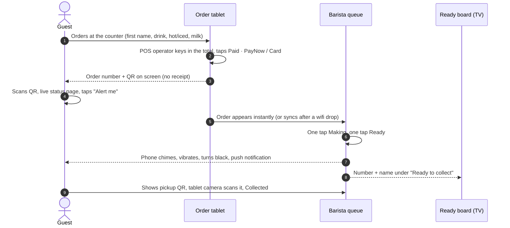

<div align="center">


<br>

**Offline-first order & pickup system for the Beans&Beats charity coffee booth at Christmas Together 2026.**<br>
Guests know the moment their drink is ready. No app to download, no paper receipts.

<br>

[](https://beans-beats-queue.onrender.com)
[](https://REPLACE-WITH-VIDEO-LINK)
[](docs/technical-summary.pdf)

[](package.json)
[](public/sw.js)
[](public/sw.js)
[](#-personal-data--pdpa)
[](package.json)
[](test/smoke.js)
[](LICENSE)

[**Live app**](https://beans-beats-queue.onrender.com) &nbsp;·&nbsp; [Demo video](https://REPLACE-WITH-VIDEO-LINK) &nbsp;·&nbsp; [Technical summary (PDF)](docs/technical-summary.pdf) &nbsp;·&nbsp; [Demo script](docs/demo-script.md)

</div>

---

## Try it

| Role | PIN | Opens |
|---|---|---|
| **Barista** | `1111` | Order screen, barista queue, ready board, guest display, scan-to-collect |
| **Booth lead** | `9999` | Everything above, plus menu controls and the daily sales report |
| **Guest** | none | Scan the QR shown after ordering, or open [`/m`](https://beans-beats-queue.onrender.com/m) for the menu |

> [!NOTE]
> The demo runs on Render's free tier: the first load after a quiet spell can take ~50 s while it wakes up, and demo data resets when the instance restarts. The live event runs on a paid instance with a persistent disk (see [Deployment](#-deployment)).

## How a cup moves through the booth



## Screenshots

<table>
<tr>
<td width="50%"><br><b>Order screen.</b> One tap per drink, options on the line, total for the POS.</td>
<td width="50%"><br><b>Barista queue.</b> Up next, Making, Ready. One tap each. Scan to collect.</td>
</tr>
<tr>
<td><br><b>Ready board.</b> For the TV at the booth. Chimes when a number turns ready.</td>
<td><br><b>Daily sales.</b> Cups, totals, PayNow vs card, CSV per order for the POS.</td>
</tr>
<tr>
<td><br><b>Staff login.</b> Tablet keypad, separate barista and lead PINs.</td>
<td>

<br>
<b>Guest status page.</b> Live progress, then a ready alert and a pickup QR.
</td>
</tr>
</table>

## ✨ What's inside

| | Module | Route | Highlights |
|---|---|---|---|
| 1 | **Order screen** | `/order` | Drink tiles with live sold-out state. Hot/iced and milk/oat chips on each line, with surcharges applied automatically. Large **Bill on POS** total. **Paid · PayNow / Paid · Card** (no cash) issues the number and guest QR. |
| 2 | **Barista queue** | `/queue` | Three lanes, one tap to advance, ages turn red after 10 min, undo/cancel under `⋯`, today's cups and average order-to-ready time. **Scan to collect** uses the tablet or laptop camera. |
| 3 | **Guest status page** | `/o/<token>` | Received, Making, **Ready to collect**. Chime, vibration, title flash, full-screen ready state and **Web Push**. Pickup QR for collection. Works on a patchy signal. |
| 4 | **Ready board** | `/board` | Full-screen TV view with ready and making lists, an arrival animation and a chime. |
| 5 | **Menu controls** | `/menu` | Prices, hot/iced, milk choice, sold-out toggles, iced and oat surcharges, add/remove drinks. Updates every tablet live, and edits made offline sync later. |
| 6 | **Daily sales report** | `/report` | KPIs, per-drink and per-hour breakdown, **CSV export** with one row per order to match the POS, **Close day** with a PDPA wipe. |
| + | Guest display | `/display` | Optional guest-facing second screen: latest order's number and QR, menu when idle. |
| + | Public menu | `/m` | Read-only live menu with sold-out marks. |

## 📶 Offline & sync

Hall wifi will drop. The booth keeps serving anyway.

- **Outbox first.** Every tap becomes an op `{uuid, type, timestamp, payload}` saved to the tablet *before* the screen updates. A dropped connection, a reload or a flat battery never loses an order.
- **One reducer everywhere.** [`public/shared/core.js`](public/shared/core.js) runs on the server *and* in every browser, so all devices compute the same state from the same ops.
- **Idempotent sync.** `POST /api/sync` accepts the outbox (retries never duplicate) and returns everything the device missed. Server-Sent Events push other tablets' changes in ~100 ms, with 3 s polling as fallback.
- **Deterministic conflicts.** Creation is first-write-wins on a UUID. Status and menu changes are last-writer-wins by timestamp, so a delayed "making" can never undo a newer "ready".
- **Collision-free numbers offline.** Each order station owns a number series (two tablets: odd / even). Numbers reset daily on Singapore time.
- **Visible state.** Header pill shows **Live** / **Offline, saved on device** / **N to sync**. ⚙ → *Simulate wifi drop* for drills and demos.

## 🔐 Personal data & PDPA

| Data | Why | Kept until |
|---|---|---|
| First name | Call-out and board | **Close day** wipes it on every device *and* in the on-disk log |
| Mobile (optional, ticked consent) | Reach the guest about this order only | Deleted when the order is collected or cancelled |
| Push subscription (opt-in) | "Ready" alert | Deleted on collection or close day |
| Items, time, amount, payment method | Sales report and POS tally | Kept (not personal) |

No surnames, emails or accounts. Payment details never touch this system; payments stay on the organiser's POS. CSV exports contain no names or mobiles. Guest links use a 128-bit random token, and there is no lookup by order number.

## 🚀 Quick start

```bash
git clone https://github.com/likalight/beans-beats-queue.git
cd beans-beats-queue
npm install
npm start          # http://localhost:3000
npm test           # end-to-end: sync, conflicts, CSV, PDPA wipe, restart
```

| Env var | Default | Purpose |
|---|---|---|
| `PORT` | `3000` | HTTP port |
| `DATA_DIR` | `./data` | Op log, keys, push subscriptions. **Persistent disk in production.** |
| `BARISTA_PIN` / `LEAD_PIN` | `1111` / `9999` | Staff PINs. **Change for the live event.** |
| `SESSION_SECRET` | auto | HMAC key for staff tokens (generated into `DATA_DIR`) |
| `VAPID_PUBLIC_KEY` / `VAPID_PRIVATE_KEY` | auto | Web Push keys |

## ☁️ Deployment

Needs **HTTPS** (service worker, push and camera access) and a **persistent disk**. Run a single instance.

- **Render (Singapore):** *New → Blueprint* → this repo. [`render.yaml`](render.yaml) creates a Starter service with a 1 GB disk at `/var/data`. Set `BARISTA_PIN` and `LEAD_PIN`.
- **Docker:** `docker build -t beans-beats-queue . && docker run -p 3000:3000 -v bbdata:/data -e BARISTA_PIN=… -e LEAD_PIN=… beans-beats-queue`

**At the booth:** open the site once per tablet on wifi and log in (caches everything for offline). Add to Home Screen. Set **⚙ → Order station number** on each order tablet. Put `/board` on the TV and tap once so it can chime. A 4G travel router as the booth's own network is recommended.

## 🔄 Resetting between event days

Order numbers restart at **001** automatically at midnight SGT.

At close, the booth lead opens **Sales → Download CSV**, then **Close &lt;date&gt; and wipe guest data**. The same from a terminal:

```bash
LEAD_PIN=yyyy node scripts/reset-day.js --url https://your-app            # close today (SGT), saves CSV
LEAD_PIN=yyyy node scripts/reset-day.js 2026-11-26 --url https://your-app  # close a specific day
node scripts/reset-day.js --wipe-all    # after the dry run: stop server first, wipes all orders
```

After `--wipe-all`, tablets notice the new data epoch and drop their cached copies automatically.

## 🧱 Stack

| Layer | Choice | Why |
|---|---|---|
| Server | Node 22, plain `http`, append-only NDJSON op log | Nothing to break on event day: one process, one file, replayable |
| Realtime | Server-Sent Events + polling fallback | Survives proxies and flaky wifi |
| Client | Vanilla JS PWA, no build step | Loads fast on budget tablets, cached for offline |
| Alerts | Web Push (`web-push`), Web Audio, Vibration API | Lock-screen alert on Android, chime and flash everywhere |
| QR | `qrcode-generator`, `jsQR` + `BarcodeDetector` | Paperless ordering and camera collection |
| Type & icons | Archivo variable (self-hosted), Phosphor | Matches the deck, works offline |

```
server.js               HTTP, sync API, SSE, push, persistence, PII scrub
public/shared/core.js   reducer, conflict rules, reports, CSV (server + browser)
public/app.js           staff app: order, queue, board, display, menu, report, scanner
public/guest.*          guest status page, alerts, pickup QR
public/sw.js            offline shell + push notifications
scripts/reset-day.js    close a day / full wipe
test/smoke.js           end-to-end test
docs/                   technical summary, demo script, screenshots
```

## ⚠️ Known limitations

- If **every** device loses the network, the order and queue tablets can't see each other's new orders until one reconnects. Each keeps working on its own. Use a 4G router, or run order and queue on one tablet during an outage.
- iPhone lock-screen push needs iOS 16.4+ and *Add to Home Screen*. Otherwise the open page chimes and turns black.
- There is no POS integration, by design: the operator keys in the total, and the CSV is the reconciliation bridge.
- Shared PIN per role, single server instance.

<div align="center">
<br>

**All profits go to Singapore Red Cross Young Hearts.**<br>
Built for Beans&Beats × Christmas Together 2026 · Hall F, Marina Bay Sands · 26 to 29 Nov

</div>
